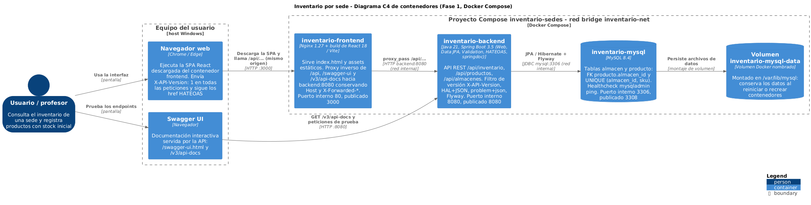

# Inventario por sede · Equipo 5

Parcial práctico final de **Arquitectura de Software** (Universidad de Antioquia).
Aplicación web que permite **registrar productos con su stock inicial en un almacén (sede)** y
**consultar el inventario de una sede** por su ID.

| Capa | Tecnología |
|---|---|
| API REST | Java 21, Spring Boot 3.5.16 (Web, Data JPA, Bean Validation, HATEOAS), springdoc-openapi 2.8.13, Flyway |
| Base de datos | MySQL 8.4 con volumen persistente |
| Frontend | React 18.3 + Vite 6, servido por Nginx 1.27 (con proxy hacia la API) |
| Contenedores | Docker Compose (3 servicios, red `inventario-net`, volumen `inventario-mysql-data`) |

> **Estado:** fase 1 completa (numerales 1 a 12 del enunciado y frontend opcional).
> **Pendiente para la fase 2:** numeral 13 (observabilidad con Prometheus/Grafana) y numeral 14 (caché con Redis y paginación).
> En la fase 1, el GET devuelve el inventario completo de la sede, sin paginación.

---

## 1. Requisitos previos

- **Docker Desktop** (con Docker Compose v2) en ejecución. Es lo único necesario para levantar la aplicación.
- Opcional, solo para desarrollo o pruebas locales: **JDK 21** (el Maven Wrapper descarga Maven), **Node.js 20+** y Chrome o Edge para la prueba de interfaz.

Puertos libres en el host: **3000** (web), **8080** (API) y **3308** (MySQL). Se pueden cambiar en `.env` (ver la sección 4).

## 2. Arranque (Windows PowerShell, desde la raíz del repositorio)

```powershell
docker compose config --quiet          # valida compose.yaml
docker compose up --build -d           # compila backend y frontend dentro de los contenedores y los inicia
docker compose ps                      # mysql (healthy), backend y frontend en "Up"
```

El backend espera a que MySQL esté *healthy* y luego Flyway crea el esquema y carga los datos iniciales.
Desde cero tarda 1 o 2 minutos. Para seguir el arranque: `docker compose logs -f backend` (termina con `Started InventarioApplication`).

### Detener y reiniciar conservando los datos

```powershell
docker compose stop            # detiene los contenedores; los datos quedan en el volumen
docker compose start           # los vuelve a iniciar
docker compose restart         # reinicio ordinario
docker compose down            # elimina contenedores y red, pero conserva el volumen inventario-mysql-data
```

Para **volver al estado inicial** (borra los productos registrados en las demostraciones):
`docker compose down -v` y luego `docker compose up --build -d`.

## 3. URLs

| Qué | URL |
|---|---|
| Frontend React | http://localhost:3000 |
| Swagger UI | http://localhost:8080/swagger-ui.html (también http://localhost:3000/swagger-ui.html) |
| Contrato OpenAPI (JSON) | http://localhost:8080/v3/api-docs |
| API: inventario de una sede | `GET http://localhost:8080/api/inventario?sedeId=1` |
| API: registrar producto | `POST http://localhost:8080/api/productos` |
| API: detalle de producto | `GET http://localhost:8080/api/productos/{id}` |
| API: sedes (auxiliar del selector) | `GET http://localhost:8080/api/almacenes` |

Todas las rutas `/api/**` exigen el encabezado `X-API-Version: 1`. Swagger UI, `/v3/api-docs` y los archivos del frontend se abren sin él.

## 4. Variables de entorno

`compose.yaml` funciona sin `.env`. Para cambiar credenciales o puertos, copie `.env.example` como `.env`
(este archivo está excluido de Git):

| Variable | Valor por defecto | Uso |
|---|---|---|
| `MYSQL_DATABASE` | `inventario` | Base de datos |
| `MYSQL_USER` / `MYSQL_PASSWORD` | `inventario` / `inventario_dev` | Usuario de la aplicación (backend lo recibe como `DB_USER` / `DB_PASSWORD`) |
| `MYSQL_ROOT_PASSWORD` | `root_dev` | Root de MySQL |
| `WEB_PORT` | `3000` | Puerto publicado del frontend |
| `API_PORT` | `8080` | Puerto publicado de la API |
| `MYSQL_PORT` | `3308` | Puerto publicado de MySQL, para inspeccionarla desde el host |

Los valores por defecto son solo para desarrollo local; no son secretos de producción.

## 5. Ejemplos de uso de la API

### PowerShell

```powershell
$h = @{ 'X-API-Version' = '1' }

# GET: inventario de la sede 1
Invoke-RestMethod -Uri 'http://localhost:8080/api/inventario?sedeId=1' -Headers $h | ConvertTo-Json -Depth 6

# POST: registrar un producto con stock inicial 20 en la sede 1
$body = @{ sedeId = 1; sku = 'ARR-001'; nombre = 'Arroz blanco de 1 kg'; stockInicial = 20 } | ConvertTo-Json
$r = Invoke-WebRequest -Uri 'http://localhost:8080/api/productos' -Method Post -Headers $h `
       -ContentType 'application/json; charset=utf-8' -Body $body -UseBasicParsing
$r.StatusCode                 # 201
$r.Headers.Location           # http://localhost:8080/api/productos/{id}
$r.Content

# Seguir el enlace self devuelto, enviando otra vez el encabezado
$self = ($r.Content | ConvertFrom-Json)._links.self.href
Invoke-RestMethod -Uri $self -Headers $h
```

`Invoke-WebRequest` de Windows PowerShell 5.1 lanza una excepción con 4xx. Para ver el cuerpo de un error, use `curl.exe`:

### curl (incluido en Windows 10/11 como `curl.exe`)

```powershell
curl.exe -i -H "X-API-Version: 1" "http://localhost:8080/api/inventario?sedeId=1"
curl.exe -i "http://localhost:8080/api/inventario?sedeId=1"                          # 400 VERSION_REQUERIDA
curl.exe -i -H "X-API-Version: 2" "http://localhost:8080/api/inventario?sedeId=1"    # 400 VERSION_NO_SOPORTADA
curl.exe -i -H "X-API-Version: 1" "http://localhost:8080/api/inventario?sedeId=999"  # 404
```

### Respuesta del POST (201 Created, `application/hal+json`)

```json
{
  "id": 8, "sku": "ARR-001", "nombre": "Arroz blanco de 1 kg", "stock": 20,
  "sedeId": 1, "sedeNombre": "Sede Medellín Centro", "creadoEn": "2026-11-27T15:40:12.345678Z",
  "_links": {
    "self":       { "href": "http://localhost:8080/api/productos/8" },
    "inventario": { "href": "http://localhost:8080/api/inventario?sedeId=1" }
  }
}
```

## 6. Reglas y decisiones de diseño

- **Modelo:** `almacen` (sede) y `producto`. Cada fila de `producto` es el inventario de un SKU en una sede:
  FK `producto.almacen_id → almacen.id`, `UNIQUE (almacen_id, sku)` y `CHECK (stock >= 0)`.
  Un mismo SKU puede estar en varias sedes con cantidades distintas.
- **Datos iniciales (Flyway `V2__datos_iniciales.sql`):** sede 1 Medellín y sede 2 Bogotá con productos.
  `ACE-001` está en ambas con stock 35 y 12. La sede 3 Cali queda vacía. Flyway registra las migraciones aplicadas, así que reiniciar no duplica la carga.
- **Validación del POST:** `sedeId` obligatorio (> 0). `sku` obligatorio, de 3 a 40 caracteres, letras, números, `.`, `-` o `_`. `nombre` obligatorio, de 2 a 120 caracteres. `stockInicial` entero obligatorio entre 0 y 1 000 000 (el 0 es válido; los decimales se rechazan).
  El SKU se normaliza quitando espacios externos y pasándolo a mayúsculas: `" arr-001 "` y `"ARR-001"` son el mismo SKU.
- **Versionamiento por custom header:** un filtro valida `X-API-Version` en todas las rutas `/api/**` y los controladores se mapean con `headers = "X-API-Version=1"`.
  Si falta el encabezado, responde **400 `VERSION_REQUERIDA`**; si la versión no está soportada, **400 `VERSION_NO_SOPORTADA`** con `versionesSoportadas: ["1"]` y la cabecera `X-API-Supported-Versions`.
- **HATEOAS (HAL):** el producto incluye `self` e `inventario`. El inventario incluye `self` (con `sedeId`), `registrar-producto`, `almacenes` y el `self` de cada producto. Cada sede incluye `inventario`.
  Los href se construyen con el host de la petición, así que funcionan tanto en `:8080` como detrás del proxy `:3000`.
- **Errores:** `application/problem+json` (RFC 9457) con `type`, `title`, `status`, `detail`, `instance`, `codigo`, `timestamp` y, según el caso, `errores[]` por campo o `productoExistente`.

| Caso | Código |
|---|---|
| Consulta válida, incluida una sede existente sin productos (`productos: []`) | 200 |
| Producto creado (con `Location`) | 201 |
| Falta `sedeId` o es inválido; cuerpo inválido; stock negativo o decimal; falta o es incorrecta la versión | 400 |
| Sede o producto inexistente (en el GET y en el POST) | 404 |
| SKU repetido en la misma sede (el stock anterior se conserva) | 409 |

## 7. Pruebas

```powershell
# 1) Pruebas automatizadas de reglas de negocio y del contrato HTTP (26 pruebas, H2 en modo MySQL; no requiere Docker)
cd backend; .\mvnw.cmd test; cd ..

# 2) Prueba de extremo a extremo contra Docker (33 comprobaciones; usa un SKU nuevo en cada corrida)
powershell -ExecutionPolicy Bypass -File .\scripts\prueba-e2e.ps1
powershell -ExecutionPolicy Bypass -File .\scripts\prueba-e2e.ps1 -ProbarReinicio   # incluye docker compose restart

# 3) Recorrido en el navegador (React + Swagger UI) con capturas en docs/capturas (usa Chrome/Edge instalado)
cd scripts\ui; npm ci; node capturas.mjs; cd ..\..
```

Los resultados se guardan en `docs/evidencias/` (`e2e-<fecha>.md/.json`, `ui-e2e-<fecha>.json`, `pruebas-backend-mvn-test.txt`).

## 8. Documentación

- Informe de la fase 1: [docs/informe-fase-1.md](docs/informe-fase-1.md)
- Diagrama C4 de contenedores: [SVG](docs/diagramas/arquitectura-c4-contenedores.svg) · [PNG](docs/diagramas/arquitectura-c4-contenedores.png) · [fuente PlantUML editable](docs/diagramas/arquitectura-c4-contenedores.puml)



## 9. Estructura

```text
backend/            API Spring Boot (Dockerfile multi-etapa, Maven Wrapper)
  src/main/java/.../domain       Entidades Almacen y Producto
  src/main/java/.../repository   Spring Data JPA
  src/main/java/.../service      Reglas de negocio
  src/main/java/.../web          Controladores, representaciones HAL y ejemplos OpenAPI
  src/main/java/.../config       Versionamiento (filtro X-API-Version) y OpenAPI
  src/main/java/.../error        Manejo central de errores (problem+json)
  src/main/resources/db/migration  Esquema y datos iniciales (Flyway)
frontend/           React + Vite, Nginx con proxy /api (Dockerfile multi-etapa)
scripts/            prueba-e2e.ps1 y scripts/ui (recorrido en navegador)
docs/               Informe, diagrama, capturas y evidencias
compose.yaml        mysql + backend + frontend, red y volumen
```

## 10. Repositorio

Repositorio público: **https://github.com/Camii1234/inventario-sedes-equipo5** · rama de entrega: `main`.

```powershell
git clone https://github.com/Camii1234/inventario-sedes-equipo5.git
cd inventario-sedes-equipo5
docker compose up --build -d
```
