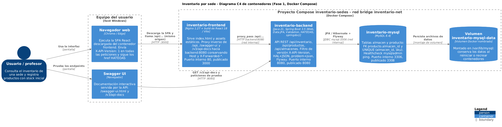
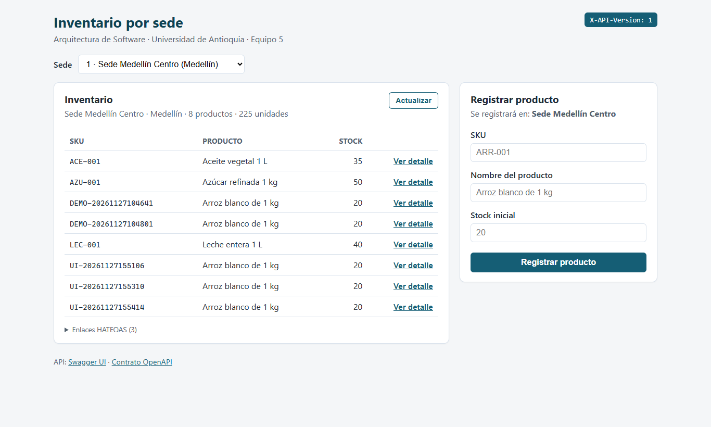
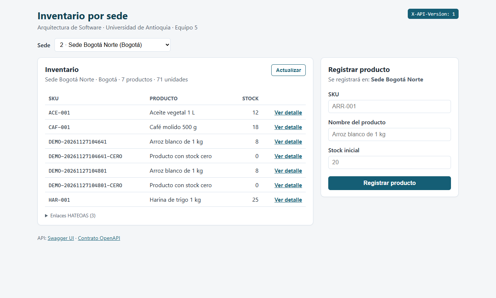
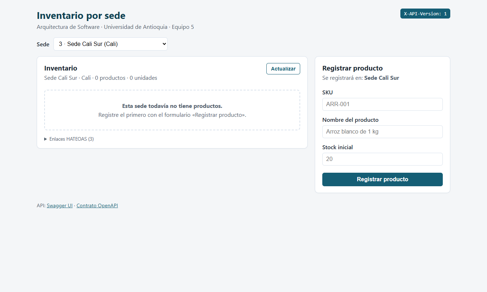
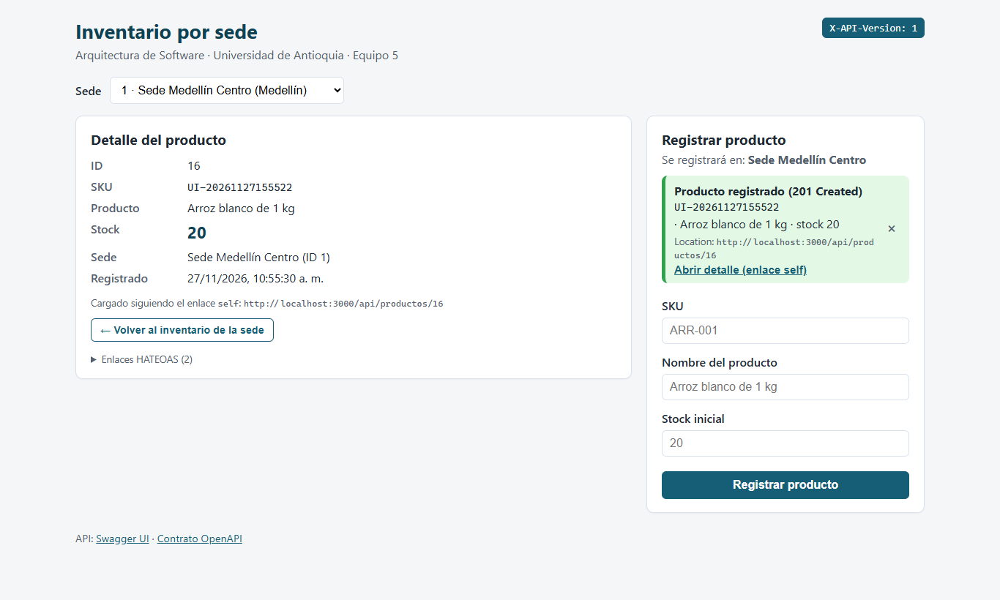
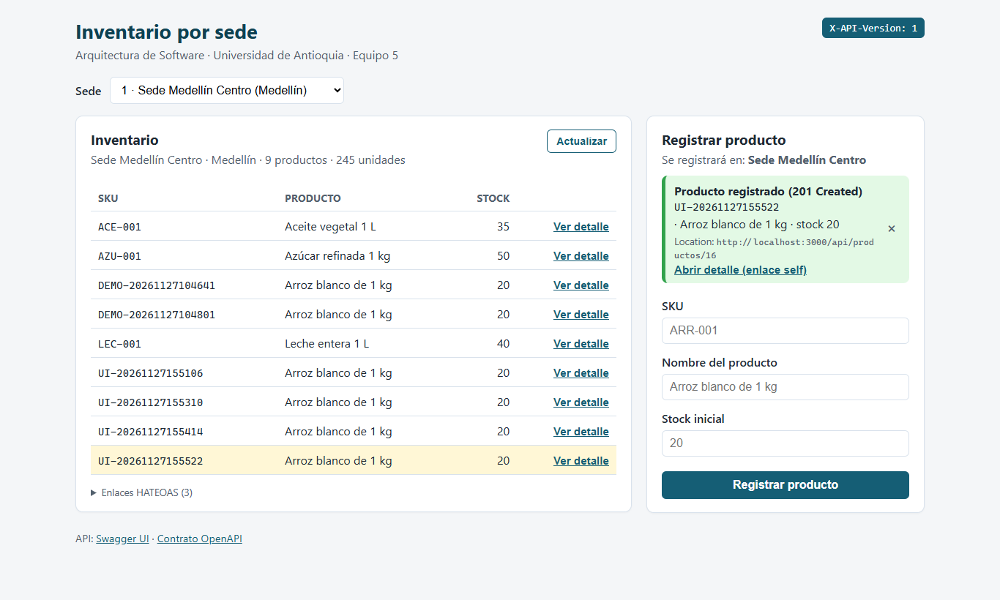
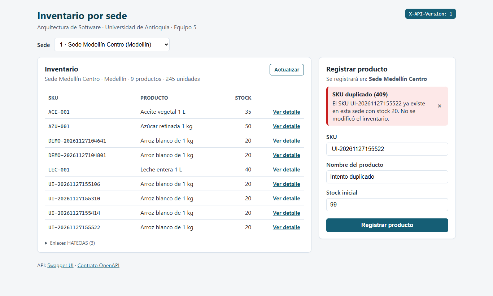
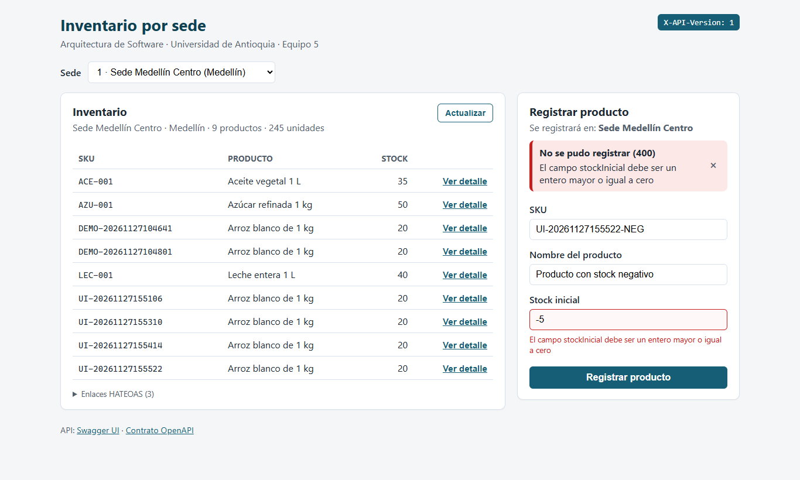
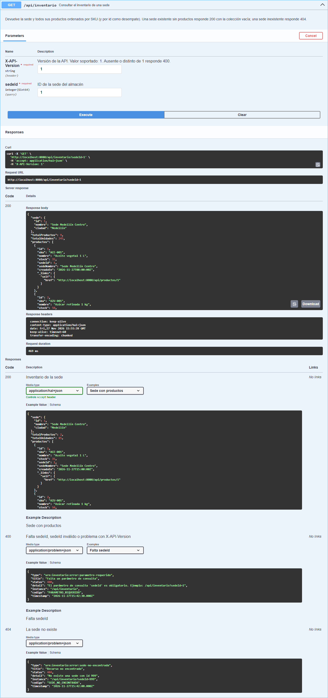

# Informe · Fase 1 · Inventario por sede

**Asignatura:** Arquitectura de Software, Universidad de Antioquia
**Equipo:** 5
**Fecha de ejecución:** 27 de noviembre de 2026
**Alcance:** numerales 1 a 12 del enunciado y frontend opcional. Los numerales 13 (observabilidad) y 14 (caché y paginación) quedan **pendientes para la fase 2**.

---

## 1. Resumen

Se construyó una aplicación web de inventario por sede compuesta por una API REST en Spring Boot, una base de datos
MySQL y un frontend en React. Las tres piezas se despliegan con Docker Compose. La API permite:

- **Consultar** el inventario completo de un almacén con `GET /api/inventario?sedeId={id}`.
- **Registrar** un producto con su cantidad inicial en stock con `POST /api/productos`.
- Consultar el detalle de un producto (`GET /api/productos/{id}`), que es el recurso al que apuntan `Location` y `self`, y
  listar las sedes (`GET /api/almacenes`) para el selector del frontend.

Resultados verificados en la ejecución real:

| Verificación | Resultado |
|---|---|
| Pruebas automatizadas del backend (`mvnw test`) | **26/26 OK** |
| Prueba E2E contra Docker (`scripts/prueba-e2e.ps1 -ProbarReinicio`, Windows PowerShell 5.1) | **33/33 OK** |
| Recorrido en navegador: React y Swagger UI (`scripts/ui/capturas.mjs`, Chrome) | **10/10 OK** |

## 2. Cumplimiento del enunciado

| # | Numeral | Estado | Dónde se evidencia |
|---|---|---|---|
| 1 | GET de inventario por ID de sede (parámetro de consulta) | Hecho | E2E 2.1–2.5, 6.4–6.7 |
| 2 | POST de productos con stock inicial | Hecho | E2E 3.1–3.3, 5.x, 6.1–6.3 |
| 3 | Base de datos relacional con las entidades Almacén y Producto | Hecho (MySQL 8.4, Flyway) | E2E 5.1–5.4, 7.2; `ReglasDatosTest` |
| 4 | OpenAPI / Swagger | Hecho | E2E 8.1–8.2; captura 09 |
| 5 | Respuestas JSON | Hecho (`application/hal+json` y `application/problem+json`) | E2E 3.1, 5.1, 6.4 |
| 6 | Versionamiento por custom request header | Hecho (`X-API-Version: 1`) | E2E 4.4, 6.8–6.10; UI-9 |
| 7 | HATEOAS | Hecho (HAL con enlaces reales) | E2E 3.3, 4.1–4.5; UI-5, UI-6 |
| 8 | Códigos de estado HTTP | Hecho (200, 201, 400, 404, 409) | Tabla de la sección 6 |
| 9 | Evidencias de funcionamiento y pruebas | Hecho | `docs/evidencias/`, `docs/capturas/` |
| 10 | Repositorio GitHub | Hecho: https://github.com/Camii1234/inventario-sedes-equipo5 (rama `main`) | Sección 8 |
| 11 | Diagrama de arquitectura | Hecho (C4 de contenedores) | `docs/diagramas/` |
| 12 | Contenedores Docker | Hecho | `compose.yaml`; E2E 1 y 7.1 |
| — | Frontend (opcional, valorado) | Hecho (React + Vite) | Capturas 01–08 |
| 13 | Observabilidad (Prometheus, Grafana) | **Pendiente: fase 2** | — |
| 14 | Caché local (Redis) y paginación | **Pendiente: fase 2** | — |

## 3. Arquitectura



Fuente editable: [`diagramas/arquitectura-c4-contenedores.puml`](diagramas/arquitectura-c4-contenedores.puml)
(PlantUML con la biblioteca C4). Imagen vectorial: [`arquitectura-c4-contenedores.svg`](diagramas/arquitectura-c4-contenedores.svg).

| Contenedor (Compose) | Imagen | Puerto interno → publicado | Se comunica con |
|---|---|---|---|
| `inventario-frontend` | Nginx 1.27 con el build de React | 80 → **3000** | `backend:8080` por HTTP, mediante el proxy de `/api`, `/swagger-ui` y `/v3/api-docs` |
| `inventario-backend` | Eclipse Temurin 21 JRE + Spring Boot | 8080 → **8080** | `mysql:3306` por JDBC |
| `inventario-mysql` | MySQL 8.4 | 3306 → **3308** | Volumen `inventario-mysql-data` montado en `/var/lib/mysql` |

- La SPA de React **se ejecuta en el navegador del usuario**. El contenedor `frontend` solo sirve los archivos estáticos y
  reenvía `/api/**` al backend por la red `inventario-net`. Como el navegador llama al mismo origen (`localhost:3000`), no hace falta CORS.
- Nginx reenvía `Host` y `X-Forwarded-*`, y Spring (`server.forward-headers-strategy: framework`) genera los enlaces HATEOAS
  con el origen público. Así, los `href` funcionan desde el navegador (`http://localhost:3000/api/...`) y también desde un
  cliente que llame directamente a la API (`http://localhost:8080/api/...`).
- El backend arranca solo cuando MySQL está *healthy* (`depends_on: condition: service_healthy` con `mysqladmin ping`).

### Estructura interna del backend

`web` (controladores y ensamblado de representaciones HAL) → `service` (reglas de negocio) → `repository`
(Spring Data JPA) → `domain` (entidades). `config` contiene el filtro de versión y OpenAPI; `error`, el manejo central de errores.

### Modelo de datos

```text
almacen (id PK, nombre, ciudad, direccion)
producto (id PK, almacen_id FK → almacen.id, sku, nombre, stock, creado_en)
   UNIQUE (almacen_id, sku)      CHECK (stock >= 0)
```

Cada fila de `producto` representa el inventario de un SKU en una sede. El mismo SKU puede existir en varias sedes con
cantidades distintas, pero no dos veces en la misma sede. El servicio aplica esta regla (409) y la base de datos la respalda
con la restricción única. Si dos peticiones simultáneas llegan a la restricción, también se traduce a 409.

## 4. Proceso de implementación

1. **Inspección.** No existía un proyecto previo compatible, así que el proyecto se creó en una carpeta nueva
   (`inventario-sedes-equipo5`). Se verificó la numeración con el enunciado original del equipo 5.
2. **Backend.** Spring Boot 3.5.16 con Java 21 y Maven Wrapper (Maven 3.9.11). El esquema y los datos iniciales se crean con
   migraciones Flyway (`V1__crear_esquema.sql`, `V2__datos_iniciales.sql`), y Hibernate se limita a validar el esquema (`ddl-auto: validate`).
3. **Contrato HTTP.** HAL con Spring HATEOAS, errores RFC 9457 con un `codigo` estable, versión por encabezado y ejemplos
   reales en OpenAPI para cada código de respuesta.
4. **Frontend.** React 18 + Vite 6 en una sola pantalla. Toda la navegación entre inventario y detalle sigue los `href` que devuelve la API.
5. **Docker.** Dockerfiles multi-etapa: el backend se compila con el wrapper dentro del contenedor y el frontend con `npm ci`
   y su lockfile. Compose define la red, el volumen y el healthcheck.
6. **Verificación.** Pruebas automatizadas, script E2E en PowerShell, recorrido en navegador con capturas y diagrama renderizado.

### Incidencias durante la ejecución y cómo se resolvieron

| Incidencia | Causa | Solución |
|---|---|---|
| Seis pruebas de errores 400 sin el campo `codigo` | `spring.mvc.problemdetails.enabled=true` registra el manejador de Spring, que tiene prioridad sobre el propio | Se quitó la propiedad; `GlobalExceptionHandler` cubre todos los casos |
| Docker Desktop no iniciaba el motor | Chequeo transitorio `WSL update required` al arrancar; WSL 2.7.3 respondía bien | Reinicio de Docker Desktop |
| `Bind for 0.0.0.0:3307 failed` | Otro proyecto local usaba el puerto 3307 | El puerto publicado de MySQL pasó a **3308** (configurable con `MYSQL_PORT`) |
| El paso de reinicio del E2E se detenía en PowerShell 5.1 | Con `ErrorActionPreference=Stop`, la salida de Docker en stderr se trata como error | Se ajustó la preferencia alrededor de las llamadas a `docker` |

## 5. Decisiones tomadas por el grupo

| Tema | Decisión |
|---|---|
| Campos del POST | `sedeId`, `sku`, `nombre`, `stockInicial`. La respuesta expone `stock`, el valor actual persistido |
| Normalización | SKU sin espacios externos y en mayúsculas; nombre sin espacios repetidos |
| Límites | SKU de 3 a 40 caracteres (`A-Z 0-9 . - _`); nombre de 2 a 120; stock entero de 0 a 1 000 000 (decimales y texto → 400) |
| POST con sede inexistente | 404 `SEDE_NO_ENCONTRADA`, igual que en el GET |
| Orden del inventario | SKU ascendente y, como desempate, `id` ascendente |
| Política de versión | Encabezado ausente → 400 `VERSION_REQUERIDA`; versión distinta de 1 → 400 `VERSION_NO_SOPORTADA` con `versionesSoportadas` y la cabecera `X-API-Supported-Versions`. La versión actúa en el filtro y en la selección del handler (`headers = "X-API-Version=1"`) |
| Rutas sin versión | `/swagger-ui/**`, `/v3/api-docs/**` y los archivos estáticos del frontend |

## 6. Tabla de pruebas (ejecución real contra Docker)

Ejecución: `powershell -ExecutionPolicy Bypass -File .\scripts\prueba-e2e.ps1 -ProbarReinicio` (Windows PowerShell 5.1).
SKU de la corrida: `DEMO-20261127104801`. Evidencia completa con los cuerpos JSON:
[`evidencias/e2e-20261127-104801.md`](evidencias/e2e-20261127-104801.md).

| Id | Operación | Esperado | Observado | Evidencia |
|---|---|---|---|---|
| 1 | `docker compose ps` | 3 servicios en ejecución | mysql (healthy), backend y frontend en Up | e2e md |
| 2.0 | `GET /api/almacenes` | 200 con 3 sedes | 200 con 3 sedes | e2e md |
| 2.1 | `GET /api/inventario?sedeId=1` | 200, sede 1, HAL | 200, Sede Medellín Centro | e2e md, captura 01 |
| 2.2 | `GET /api/inventario?sedeId=2` | 200, sede 2 | 200, Sede Bogotá Norte | e2e md, captura 02 |
| 2.3 | SKU compartido `ACE-001` | stock distinto por sede | sede 1 = 35, sede 2 = 12 | e2e md |
| 2.4 | Aislamiento entre sedes | ningún registro de otra sede | 0 registros ajenos en cada sede | e2e md |
| 2.5 | Orden estable | ordenado por SKU | ACE-001, AZU-001, DEMO-…, LEC-001 | e2e md |
| 3.1 | `POST /api/productos` (stock 20, sede 1) | 201 Created | 201 `application/hal+json`, stock 20 | e2e md (JSON) |
| 3.2 | Cabecera `Location` | igual a `_links.self.href` | `http://localhost:8080/api/productos/10` | e2e md |
| 3.3 | Enlaces del POST | `self` e `inventario?sedeId=1` | ambos presentes y correctos | e2e md |
| 4.1 | Seguir `self` con `X-API-Version` | 200, mismo producto, stock 20 | 200, sede 1, stock 20 | e2e md |
| 4.2 | Seguir `inventario` | 200, sede 1 con el producto | 200, stock 20 | e2e md |
| 4.3 | Seguir `self` de un producto del inventario | 200 | 200, ACE-001 | e2e md |
| 4.4 | Seguir `self` sin encabezado | 400 `VERSION_REQUERIDA` | 400 `VERSION_REQUERIDA` | e2e md |
| 4.5 | HATEOAS detrás del proxy (`:3000`) | `href` con origen `:3000` y navegable | `http://localhost:3000/api/inventario?sedeId=1` → 200 | e2e md |
| 5.1 | Repetir el SKU en la sede 1 (minúsculas y espacios, stock 99) | 409 | 409 `SKU_DUPLICADO_EN_SEDE`: «… El stock registrado (20) no se modificó.» | e2e md (JSON), captura 07 |
| 5.2 | Stock tras el 409 | 20 | 20 | e2e md |
| 5.3 | Mismo SKU en la sede 2 con stock 8 | 201 | 201, sede 2, stock 8 | e2e md |
| 5.4 | Ambos valores | sede 1 = 20, sede 2 = 8 | sede 1 = 20, sede 2 = 8 | e2e md |
| 6.1 | Stock 0 | 201 | 201, stock 0 | e2e md |
| 6.2 | Stock −5 | 400 en `stockInicial` | 400 `VALIDACION_FALLIDA` | e2e md (JSON), captura 08 |
| 6.3 | POST con sede 999 | 404 | 404 `SEDE_NO_ENCONTRADA` | e2e md |
| 6.4 | GET con sede 999 | 404 | 404 `SEDE_NO_ENCONTRADA` (`problem+json`) | e2e md (JSON) |
| 6.5 | GET de la sede vacía (3) | 200 con `productos: []` | 200, Sede Cali Sur, 0 productos | e2e md (JSON), captura 03 |
| 6.6 | GET sin `sedeId` | 400 | 400 `PARAMETRO_REQUERIDO` | e2e md |
| 6.7 | `sedeId=abc` | 400 | 400 `PARAMETRO_INVALIDO` | e2e md |
| 6.8 | Sin `X-API-Version` | 400 `VERSION_REQUERIDA` | 400 «La petición debe incluir el encabezado X-API-Version…» | e2e md (JSON) |
| 6.9 | `X-API-Version: 2` | 400 `VERSION_NO_SOPORTADA` | 400 «La versión '2' no está soportada. Versiones admitidas…: 1.» | e2e md (JSON) |
| 6.10 | POST sin encabezado | 400 | 400 `VERSION_REQUERIDA` | e2e md |
| 7.1 | `docker compose restart` y luego `GET self` | datos conservados | 200, stock 20 | e2e md |
| 7.2 | Carga inicial no duplicada | 3 sedes, un `ACE-001` en la sede 1 | 3 sedes, `ACE-001` ×1 | e2e md |
| 8.1 | Swagger UI y `/v3/api-docs` sin encabezado | 200; contrato con `X-API-Version` | 200 / 200; encabezado documentado | e2e md, captura 09 |
| 8.2 | Frontend y OpenAPI por `:3000` | 200 | 200 / 200 | e2e md |

### Recorrido en el navegador (React + Swagger UI)

Ejecución: `scripts/ui/capturas.mjs` con Chrome en modo headless contra `http://localhost:3000` y `http://localhost:8080`.
Evidencia: [`evidencias/ui-e2e-20261127155522.json`](evidencias/ui-e2e-20261127155522.json). Resultado: **10/10 OK**.
La comprobación UI-9 verificó que las 11 peticiones `/api` del navegador, incluidas las que siguen enlaces HATEOAS,
enviaron `X-API-Version: 1`.

| Captura | Qué muestra |
|---|---|
|  **01** | Inventario de la sede 1: nombre del almacén, SKU, producto y stock (ACE-001 = 35) |
|  **02** | Sede 2: ACE-001 = 12 y sin productos de la sede 1 |
|  **03** | Estado visual de una sede sin productos (sede 3) |
|  **04** | Confirmación «Producto registrado (201 Created)» con Location, e inventario actualizado con la fila resaltada |
|  **05** | Detalle cargado siguiendo el enlace `self` |
|  **06** | Regreso al inventario siguiendo el enlace `inventario` |
|  **07** | Mensaje comprensible de SKU duplicado (409); el stock sigue en 20 |
|  **08** | Stock negativo: mensaje de la API junto al campo |
|  **09** | Swagger UI: *Try it out* de `GET /api/inventario?sedeId=1` con `X-API-Version: 1` y respuesta 200 |

### Pruebas automatizadas del backend

`backend/src/test/java/.../InventarioApiTest.java` (22 pruebas de contrato HTTP con MockMvc) y `ReglasDatosTest.java`
(4 pruebas de la capa de datos: restricción única, mismo SKU en dos sedes, orden estable y normalización).
Se ejecutan con H2 en modo MySQL y los mismos datos iniciales. Resultado: **26 pruebas, 0 fallas**
([`evidencias/pruebas-backend-mvn-test.txt`](evidencias/pruebas-backend-mvn-test.txt)).

## 7. Cómo repetir la demostración

```powershell
docker compose up --build -d
docker compose ps
powershell -ExecutionPolicy Bypass -File .\scripts\prueba-e2e.ps1 -ProbarReinicio
cd scripts\ui; npm ci; node capturas.mjs; cd ..\..
```

Cada corrida usa SKUs nuevos (`DEMO-<fecha-hora>` y `UI-<fecha-hora>`), así que se puede repetir sin limpiar la base.
Para mostrar la sede 1 solo con los datos iniciales: `docker compose down -v` y luego `docker compose up --build -d`.

### Capturas que deben tomarse en el computador del equipo

Estas capturas muestran la terminal o el escritorio del equipo, así que no se generan de forma automática:

1. **Terminal PowerShell en la raíz:** ejecutar `docker compose ps`. Deben verse los tres contenedores, `inventario-mysql (healthy)` y los puertos 3000, 8080 y 3308.
2. **Terminal:** ejecutar `.\scripts\prueba-e2e.ps1 -ProbarReinicio`. Debe verse la lista en verde y la línea `Resultado: 33 de 33 comprobaciones OK`.
3. **Terminal:** ejecutar `cd backend; .\mvnw.cmd test`. Debe verse `Tests run: 26, Failures: 0` y `BUILD SUCCESS`.
4. **Docker Desktop → Volumes:** debe verse `inventario-mysql-data` en uso.

## 8. Repositorio

Repositorio público: **https://github.com/Camii1234/inventario-sedes-equipo5** (rama de entrega `main`).
El `.gitignore` excluye `.env`, `node_modules`, `target` y `dist`. Las credenciales que aparecen en `compose.yaml` y
`.env.example` son valores por defecto de desarrollo local, no secretos reales.

## 9. Pendiente

- **Fase 2, numeral 13:** observabilidad (métricas, Prometheus y Grafana).
- **Fase 2, numeral 14:** caché local con Redis y paginación de las API. El GET de la fase 1 devuelve el inventario completo, sin parámetros `page` ni `size`.
- Tomar las capturas de terminal descritas en la sección 7.
