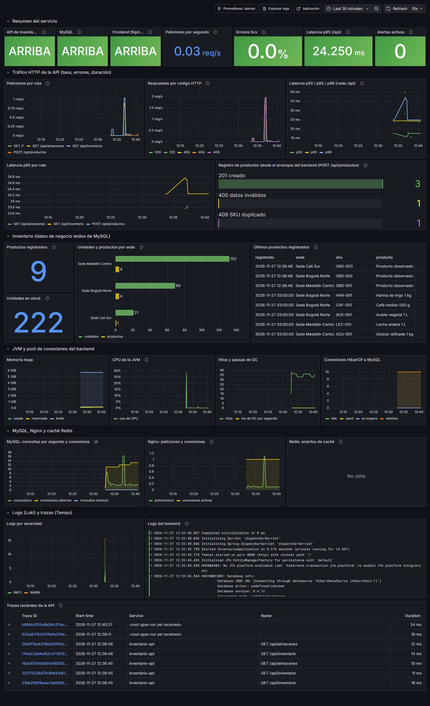
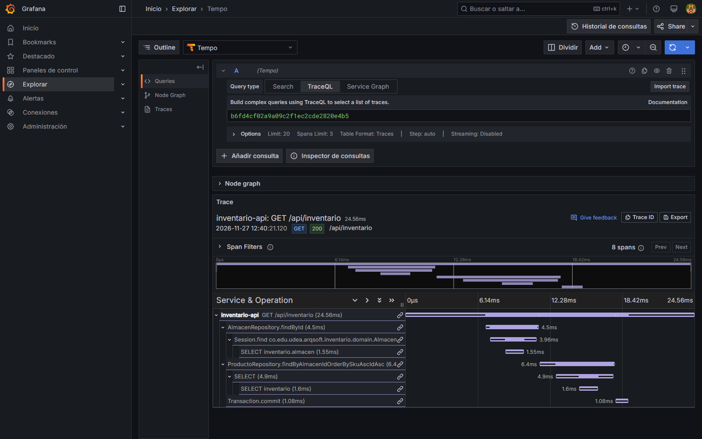

# Informe · Fase 2 · Numeral 13: Observabilidad

**Asignatura:** Arquitectura de Software, Universidad de Antioquia · **Equipo:** 5 · **Fecha:** 27 de noviembre de 2026

## 1. Resumen

Se integró una pila de observabilidad que cubre los tres pilares (**métricas, trazas y logs**), además de **alertas**
y **datos de negocio**, todo visible en Grafana:

| Pilar | Herramienta | Origen de los datos |
|---|---|---|
| Métricas | **Prometheus 3.2** | Agente OpenTelemetry del backend (`backend:9464`), `mysqld-exporter`, `nginx-exporter`, `redis-exporter` y la propia pila |
| Trazas | **Tempo 2.7** | Agente OpenTelemetry → OTLP HTTP (`tempo:4318`). Cada petición incluye sus spans de repositorio, Hibernate y SQL |
| Logs | **Loki 3.4** | Agente OpenTelemetry → OTLP (`loki:3100/otlp`). Cada línea lleva `trace_id` y `span_id` |
| Alertas | Reglas de Prometheus | `observabilidad/prometheus/alertas.yml` (7 reglas) |
| Visualización | **Grafana 11.5** | Tablero provisionado «Inventario por sede · Observabilidad» (26 paneles) |
| Negocio | Grafana → MySQL | Usuario de **solo lectura** `grafana_lector` creado por un contenedor de inicialización |

Resultado de la verificación (`scripts/prueba-observabilidad.ps1 -ProbarAlerta`): **16/16 OK**.
Recorrido visual (`scripts/ui/capturas-observabilidad.mjs`): **6/6 OK**.

## 2. Decisiones de diseño

- **Instrumentación sin cambiar el código de la API.** Se usa el *OpenTelemetry Java agent* 2.33.1. El `Dockerfile` lo descarga
  de Maven Central y lo deja en la imagen, pero solo se activa con `JAVA_TOOL_OPTIONS=-javaagent:...`, que se define en
  `compose.override.yaml`. Así, la observabilidad es una preocupación transversal desacoplada de la lógica de negocio
  y no requiere tocar `pom.xml` ni `application.yml`.
- **`compose.override.yaml`.** Docker Compose lo combina automáticamente con `compose.yaml` en `docker compose up`.
  La aplicación sola se puede levantar con `docker compose -f compose.yaml up -d`.
- **Correlación métricas ↔ trazas ↔ logs.**
  - *Exemplars*: el histograma de latencia guarda el `trace_id` de peticiones reales; en el panel p95 se hace clic en un punto y se abre la traza.
  - *Logs → trazas*: el campo `trace_id` de Loki enlaza a Tempo («Ver traza en Tempo»).
  - *Trazas → logs*: desde un span de Tempo se consultan los logs de esa traza.
- **Una línea de log por petición.** `DispatcherServlet` en nivel DEBUG registra «GET /api/...» y «Completed 200 OK» con su `trace_id`.
- **Redis descubierto por DNS.** El objetivo `redis` de Prometheus usa `dns_sd_configs`: si Redis no está desplegado no hay objetivo ni alerta falsa.

## 3. Tablero de Grafana



| Fila | Paneles |
|---|---|
| Resumen | Estado de API, MySQL y Nginx; peticiones/s; % de errores 5xx; latencia p95; alertas activas |
| Tráfico HTTP (método RED) | Peticiones por ruta, respuestas por código (200/201/400/404/409), latencia p50/p95/p99 con exemplars, p95 por ruta, resultados del POST |
| Inventario (MySQL) | Productos registrados, unidades en stock, unidades y productos por sede, últimos productos registrados |
| JVM y pool | Heap, CPU, hilos y GC, conexiones HikariCP (usadas, libres, en espera) |
| MySQL, Nginx y Redis | Consultas/s y conexiones de MySQL; peticiones y conexiones de Nginx; tasa de aciertos de la caché Redis |
| Logs y trazas | Logs por severidad, logs del backend, trazas recientes de la API |

## 4. Alertas (`observabilidad/prometheus/alertas.yml`)

| Alerta | Condición | Severidad |
|---|---|---|
| ApiInventarioCaida | `up{job="inventario-api"} == 0` durante 30 s | crítica |
| MySQLNoDisponible | `mysql_up == 0` durante 30 s | crítica |
| ComponenteMonitoreadoCaido | cualquier otro objetivo caído 1 min | advertencia |
| TasaErrores5xxAlta | > 5 % de respuestas 5xx en 5 min | crítica |
| LatenciaP95Alta | p95 de una ruta `/api` > 500 ms durante 5 min | advertencia |
| MemoriaHeapAlta | heap > 90 % durante 5 min | advertencia |
| PoolConexionesConEspera | peticiones esperando conexión a MySQL durante 1 min | advertencia |

**Prueba real:** al detener el backend, `ApiInventarioCaida` pasó a *firing* a los 51 s. Al iniciarlo de nuevo, se resolvió.

## 5. Evidencias

| Evidencia | Archivo |
|---|---|
| Verificación automatizada (16/16) | `docs/evidencias/observabilidad-ultimo.md` |
| Recorrido visual (6/6) | `docs/evidencias/observabilidad-ui-ultimo.json` |
| Tablero de Grafana | `docs/capturas/observabilidad/01-grafana-tablero.png` |
| Objetivos de Prometheus (7/7 arriba) | `docs/capturas/observabilidad/02-prometheus-objetivos.png` |
| Reglas de alerta | `docs/capturas/observabilidad/03-prometheus-reglas-alerta.png` |
| Logs en Loki | `docs/capturas/observabilidad/04-grafana-logs-loki.png` |
| Traza en Tempo (HTTP → repositorio → SQL) | `docs/capturas/observabilidad/05-grafana-traza-tempo.png` |



## 6. Cómo ejecutarlo

```powershell
docker compose up --build -d          # aplicación + observabilidad
powershell -ExecutionPolicy Bypass -File .\scripts\prueba-observabilidad.ps1 -ProbarAlerta
cd scripts\ui; npm ci; node capturas-observabilidad.mjs; cd ..\..
```

| Herramienta | URL | Acceso |
|---|---|---|
| Grafana | http://localhost:3001 | anónimo (lectura) o `admin` / `admin` (para usar Explore) |
| Prometheus | http://localhost:9090 (`/targets`, `/alerts`) | libre |
| Métricas crudas del backend | `docker exec inventario-prometheus wget -qO- http://backend:9464/metrics` | interno |

Variables opcionales en `.env`: `GRAFANA_PORT`, `PROMETHEUS_PORT`, `GRAFANA_ADMIN_USER`, `GRAFANA_ADMIN_PASSWORD`, `GRAFANA_DB_PASSWORD`.

## 7. Limitaciones

- Las credenciales por defecto son de desarrollo; `mysqld-exporter` usa root solo en este entorno.
- Tempo guarda las trazas en el sistema de archivos del contenedor (se pierden al recrearlo); Prometheus y Loki usan volúmenes.
- No se configuró Alertmanager: las alertas se consultan en Prometheus y en el panel «Alertas activas».
